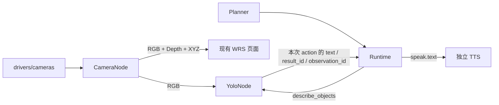

# 相机、视觉结果与播报

相机和 YOLO 是独立节点；原始数组直接流向消费者，Agent 只调度技能和小型结果。
本轮接通 D405 驱动、合成相机、YOLO 适配器、现有 WRS 页面与 `describe_objects → speak`。
SAM3、GraspNet、物体到机器人世界坐标的转换尚未实现。



## 数据与有界缓存

每次采集一份 SDK frameset，生成 `observation_id = stream_id.sequence`：

| 分量 | 格式 | 合同 |
|---|---|---|
| RGB | uint8[H,W,3] | RGB；RealSense 保留原始彩色图，不按深度有效性遮黑 |
| Depth | uint16[H,W] | RealSense 对齐到彩色网格；乘 depth_scale_m 得到米 |
| XYZ | float32[H,W,3] | 必需输出；与 RGB/Depth 同一网格、米，z≤0 无效 |

点云由 RealSense SDK 在采集线程生成，消费者不用从深度重建。颜色直接使用对应 RGB
视图，不复制浮点颜色。RealSense 使用 `rs.align(rs.stream.color)`，在对齐后的深度上
生成 XYZ，并读取该帧的彩色网格内参。观测标记 `alignment=color_grid`、
`frame_id=realsense-<serial>-color-optical`；合成数据仍为 `depth_grid` / 深度光学坐标。
光学坐标 x 向右、y 向下、z 向前，尚未转换到机器人 world。旧 depth-optical 外参不能
直接改名复用，需要对应的彩色光学坐标外参；Environment 会拒绝坐标名称不匹配的标定。
内参、畸变、深度比例内嵌于观测；时间戳为主机收到帧的时间，非硬件曝光时刻。

旧版驱动把 RGB 对齐到深度，SDK 会将缺失深度或无法映射的位置留成黑色，导致 RGB
预览也出现空洞，影响识别。[SDK v2.56.5 对齐实现](https://github.com/IntelRealSense/librealsense/blob/v2.56.5/src/proc/align.cpp)
明确跳过零深度像素。现改为保留彩色图；无效深度和 XYZ 仍为零，不插值伪造距离。
升级后需重启相机和消费者，以加载新的对齐方向及元数据合同。

相机最多保留 **2 帧、64 MiB、5 秒 TTL**，不落盘。848×480 的 RGB/Depth/XYZ 每帧
约 6.6 MiB，双帧约 13.2 MiB；这不是总进程 RSS，SDK/网络/消费者另有在途副本。
采集到事件循环的邮箱只保留一份最新帧。查询序列化期间临时持有指定帧，不锁住采集。

消费者一次选择编号和分量，所有数组来自同一观测。消费者推理期间保有自己取得的输入。
服务端不会永久保存这个编号；过期返回 `observation_expired`，不暗中改取新帧。
未来串联 YOLO→SAM3→GraspNet 时，应由任务保有原始输入，或新增限量、限时的保留接口；
本轮没有跨模型长任务的 pin/lease 服务，也不保留无限历史。

## Zenoh 合同

相机默认 target 为 `<env_id>-camera`，路径位于 `wrs/v4/<site>/<target>/`：

| 路径 | 内容 |
|---|---|
| stream/camera/observation | 小型元数据，允许丢旧保新 |
| request/camera/status | 连接状态、来源、年龄、缓存字节 |
| request/camera/frame | observation_id?、components、max_age_s；认证二进制 Query |
| stream/vision/objects（YOLO target） | 至多 32 个二维对象及观测身份 |
| request/vision/result（YOLO target） | 按 result_id 查询，最多保留最近 8 份 |
| request/vision/frame（YOLO target） | 按 result_id 读取推理时 RGB；认证二进制 Query，至多两份、采集起两秒有效 |

数据包为 4 字节 little-endian header 长度、JSON header、所选数组的原始字节，不使用
pickle 或 base64 图像 JSON。`CameraClient.read()` 返回 `(observation, arrays, age_s)`；
年龄取自同一帧并加上完整网络往返时间，作为保守上界，不依赖跨主机时钟同步。
回复上限 32 MiB，数据入口队列 2、单 worker，客户端最多两个在途数据查询。
控制保留独立队列和 64 KiB JSON 上限。部署仍限定本机回环。

节点与客户端需同步更新，以使用新增的结果/输入字段。目录中的相机节点 ready 表示
查询服务可用；设备是否有新帧以 `request/camera/status` 为准。

这使用进程内有界缓存与 Zenoh Query，无需新增存储服务，也不把总线缓存当成任务授权。

## 驱动、模型与技能

`drivers/cameras/` 不依赖 WRS、Zenoh 或模型；`nodes/camera/` 管采集生命周期、缓存和
预览；`nodes/vision/` 管推理；`skills/vision/` 只选择结果并生成确定性短文本。
旧 `D:\code\wrs\wrs\drivers\devices\realsense\realsense_d400s.py` 的 frameset/点云
采集流程是本实现的参考。旧文件本身不导入 WRS；这里保留独立采集和点云生成，未迁移
其 ArUco/脚本可视化与每次重新采集的分离 getters，增加数组所有权、深度比例、帧身份
和关闭/重连。保留许可于
`wrs_agent/drivers/cameras/LICENSE.legacy-wrs`，不复制旧 drivers 整棵目录。
本轮参考的旧驱动文件 SHA256：
`20f56a218f7a2eecbce95726d26658a55cff3239583e91965810b884e47b5b9f`。

### 2026-10-13：与用户旧驱动逐项对照

重新读取上述绝对路径并用 Get-FileHash 核对，SHA256 与参考记录一致。当前是部分迁移，
并非原接口的完整替代。旧 `stream_data()` 保留原始 BGR/Depth，在原生深度上生成 XYZ，
再通过 `map_to`/纹理坐标配色；没有 `rs.align`。此前 RGB 黑洞来自新实现额外引入的
彩色到深度对齐，不是继承的旧行为。目前修复后的 XYZ 由对齐到彩色的深度生成，仍与
旧驱动的原生深度点云不同；软件帧回归没有验证真实设备的几何精度。

| 旧驱动能力 | 当前状态 |
|---|---|
| `find_devices()`，打印型号/序列号 | 未迁移；只有默认设备解析和指定序列号 |
| `req_data()` / `get_pcd_texture_depth()` 同 frameset 输出 | 由 `read()` / CameraFrame 承担；数组拥有独立只读内存 |
| 原生深度 XYZ + UV 映射颜色 | 当前仅输出彩色网格 XYZ；原生深度/XYZ/UV 入口缺失 |
| `intr_mat` / `intr_distcoeffs` | 内参/畸变已在 calibration 中；未提供 K 矩阵便捷属性 |
| `get_color_img()` / `get_depth_img()` / `get_pcd()` | 改为一次读帧后取分量，避免各 getter 重新采集不同帧 |
| mid/high 和 30 FPS | 底层可配置宽高/帧率，默认 848×480、15 FPS；camera/grasping 示例显式设为 30 FPS，设备支持仍需核实 |
| `recognize_ar_marker()` 输出标记位姿 | 未迁移；应作为独立视觉函数，显式使用所选帧及内参 |
| 按序列号创建多个实例的脚本 | 底层支持指定设备，缺设备列表及完整多相机示例；旧脚本也无硬件同步 |
| `stop()` / `reset()` / `__del__()` | 有显式幂等 close；不自动硬件复位，不依赖析构关闭 |

后续建议（尚未实现）：优先补原生深度/XYZ 与 UV、RGB/深度各自内参和二者外参，让
原始几何及对齐视图显式区分并共享帧身份；补设备信息、可用流配置和具体错误原因，
避免所有 SDK 错误仅显示 camera_disconnected。接着补独立 ArUco 位姿/标定示例，已有
Environment 外参加载只读取和检查矩阵，不会自动估计相机到机器人变换。
曝光/增益设置、硬件帧号/时间戳属于两版都没有的新能力，可按实测需要补；传感器选项
必须先查询支持情况。当前接收时间不能作为曝光时间。设备硬件复位和废弃多进程类不
作为默认补齐项。保持示例顶部常量配置，不增加命令行参数。

YOLO 默认 CPU、最多 5 次推理/秒、一次只执行一个推理，模型加载一次。只接受本地 `.pt`，
不下载权重。节点校验文件与传入的 SHA256 一致；02 示例自动计算用户选定本地文件的
指纹，不再要求手填。自算指纹用于记录身份，不是独立来源认证；需要严格固定版本时，
部署方仍可给节点传入预先核验的哈希。按[官方输入合同](https://docs.ultralytics.com/modes/predict/)
把 RGB 转为 BGR，输出像素 xyxy 框、类别、置信度和来源。没有承诺实际推理帧率。
置信度过滤已经在推理入口生效：YoloOptions.confidence 默认 0.35，传给
model.predict(conf=...)。02 顶部的 `CONFIDENCE = 0.35` 可直接调整（0 < 值 <= 1），
修改后重启 02；过滤影响发布的检测、物体描述及定位结果，并非仅隐藏预览里的框。
调高可减少低分结果，也可能漏掉目标；检测分数不等于实际识别正确概率。

YOLO/SAM3 可共享观测编号、实例编号、框、可选 mask 引用等几何部分，但应保留标签来源、
提示词和分数语义。当前 `Objects2D` 只实现 YOLO 置信度；SAM3 接入时扩展其分数种类和
掩码合同，不声称现有代码已经运行 SAM3。[SAM3 官方实现](https://github.com/facebookresearch/sam3)。

**GraspNet baseline 的网络输入是 XYZ 点云**。官方 demo 默认采样 20,000 点到
`point_clouds`；深度和内参用于准备点云，颜色另存。以后可直接读取本项目 XYZ，过滤
无效点、选工作区/实例并采样。抓取候选需要独立 3D 合同及 Environment 的碰撞/权限检查。
[官方 demo](https://github.com/graspnet/graspnet-baseline/blob/main/demo.py)。

`describe_objects` 选取足够新鲜的结果，返回 `text / result_id / observation_id`，保存于
该 action 的成功状态。Runtime 的 `Step.inputs` 只允许引用依赖步骤的输出，并校验输出
类型及目标技能声明的可绑定参数；取到实际值后再次校验。当前 `speak.text` 允许绑定，
机器人参数未开放此能力。取消后的迟到结果不能触发播报。

```python
see = step("describe_objects")
say = step("speak", after=see,
           inputs={"text": {"step_id": see.step_id, "field": "text"}})
task = await system.start(see, say)
```

默认播报“画面中识别到……”。只有设置 `02_start_yolo.py` 的 `TABLE_ROI = [x1, y1, x2, y2]`
（归一化坐标）才说“桌面区域”，
含义是框中心位于人工指定区域，不表示验证了 3D 支撑关系。零检测说“未识别到物体”，
不说“桌子是空的”。合成输入始终标明“合成测试”。结果不可用时等待后失败，不播报旧内容。

## 运行例子

当前 camera/01、02、06 已配置为 **语音 07/09（8001 页面）**，配置与顺序见
[语音相机配置](../examples/voice/README.md#在语音页面看相机通过语音调用-yolo)
：三项 ENDPOINT / ENV_ID / SESSION 为 `tcp/127.0.0.1:7451` / `voice-goal` / `voice`，
由 voice/07 提供 Router、Agent、TTS；可直接运行 07 → 01 → 02 → 09，06 联合预览可选。

下面的 00 → 01 → 02 → 06 是独立相机模式（7449）；使用这套命令前，必须将
01、02、06 的三项配置一起改回 `tcp/127.0.0.1:7449` / `wrs-demo` / `wrs`。
两种环境不会自动互通，启动顺序不能弥补配置差异。

`01_start_camera.py` **不会启动 Zenoh Router**，`06_read_frame.py` 也只连接已有服务。
独立相机模式连接 `tcp/127.0.0.1:7449`，属于 `wrs-demo` 环境、使用 `wrs` 会话口令。
插入 D405 不会创建这个网络服务；直接运行 01 或 06，若 Router 尚未启动，都会在
`zenoh.open` 报 `Unable to connect to any of [tcp/127.0.0.1:7449]`，此时尚未读取相机。
本目录全部例子无命令行参数，需要调整的配置直接写在各文件顶部。
先运行本组的 `00_start_router.py`，再运行 01、02，最后运行 06；00 自动准备本机共享
口令，只启动 Router。前三个进程保持运行，Ctrl+C 分别关闭；06 是交互预览窗口。
只看 RGB 可省略 02，不需要 TTS、Agent 或播报任务。

在仓库根目录，每个常驻进程各开一个终端。相机依赖按真实 uv.lock 显式安装，不下载模型：

```powershell
$py = 'D:/code/venv312/.venv/Scripts/python.exe'
$uv = '.local/tools/bin/uv.exe'
& $uv --cache-dir .local/uv-cache export --frozen --extra camera --extra realsense --extra llm --no-emit-project --output-file .local/camera-requirements.txt
& $uv --cache-dir .local/uv-cache pip sync --python $py --target .local/deps --require-hashes .local/camera-requirements.txt
```

```powershell
# 终端一：先启动本组 Router，保持运行。
# 每个新终端都需重新设置 $py，工作目录均为仓库根目录。
$py = 'D:/code/venv312/.venv/Scripts/python.exe'
& $py -X utf8 -S scripts/run.py examples/camera/00_start_router.py

# 终端二：按文件顶部 BACKEND 选择相机，保持运行；D405 配置见下方。
$py = 'D:/code/venv312/.venv/Scripts/python.exe'
& $py -X utf8 -S scripts/run.py examples/camera/01_start_camera.py

# 终端三：使用已安装 YOLO 依赖的 Python，加载已有本地权重；不自动下载。
& 'D:/code/venv312/.venv/Scripts/python.exe' -m examples.camera.02_start_yolo

# 终端四：OpenCV 同时显示 RGB、接收 FPS 和 YOLO 结果；Q/Esc 或关闭窗口退出。
$py = 'D:/code/venv312/.venv/Scripts/python.exe'
& $py -X utf8 -S scripts/run.py examples/camera/06_read_frame.py

```

`-S scripts/run.py` 使用项目 `.local/deps`，避免直接运行时加载共享环境中不同版本的依赖。
camera extra 包含带窗口支持的 `opencv-python`。06 仅请求 RGB，先转为 OpenCV 使用的
BGR 再显示，不下载整帧点云。FPS 按每秒收到的不同 `observation_id` 统计，重复图像不会
重复计数；它是这个消费者的接收帧率，不是相机标称帧率或窗口刷新频率。
一秒没有新鲜帧会清空旧画面并显示等待，退出关闭窗口和客户端连接，01 继续采集。
06 左侧显示实时 RGB，右侧显示 YOLO 推理时的原图，叠加检测框、类别和置信度。
后台至多每 0.2 秒读取一次 YOLO 状态，新 result_id 才查询结果与配套 RGB。节点只保留
最近两份推理 RGB，采集起两秒过期，不写磁盘；使用已有相机二进制格式，不下载深度
或点云。客户端校验观测编号、相机会话、来源、采集时间和尺寸后才绘框；实时画面
即使已经前进，右侧仍与框严格配对。下方分别标明两个 observation_id，提示检测画面可能滞后。
重复结果/下载不延长有效期；过期、节点不可用或来源相机会话不同时清除检测显示。
有效的空列表单独显示“No objects detected”，不将节点故障解释成没有物体。
更新后重启 02 和 06；旧版 YOLO 没有 request/vision/frame，无法提供同帧标注。
读取已有结果不会触发额外推理或播报，也不依赖 03/04/05。
Depth/XYZ 仍由相机节点提供，其他消费者可继续用 `CameraClient.read()` 读取。

如果需要 WRS 页面，将终端一的 00 **替换为** `examples/wrs/05_start_node.py`，
再另开终端运行 `examples/wrs/07_viewer.py`；不要同时启动两个占用 7449 的 Router。
这两个 WRS 例子使用虚拟后端。相机的 00 → 01 → 02 → 06 不需要 WRS 节点或 viewer。
打开 `http://127.0.0.1:8000` 可看到 WRS 页面。相机面板有 RGB/深度/点云标签；点云直接
绘制到 WRS 主场景，不再建立小窗口 canvas。RGB/深度预览上限 30 FPS，点云预览上限
5 FPS、至多 8192 点，在像素网格两个方向均匀采样。面板显示每秒实际收到的
不同观测数；此数值取决于采集、传输和编码耗时，不保证达到配置上限。
浏览器只请求当前标签；后端仅获取对应分量（点云视图取 RGB+XYZ），不重复编码同一帧。
一个 worker 串行处理、最多缓存四个视图（含抓取快照），最后一次请求过去 1.5 秒后停止读取并
清理缓存。未连接时显示提示，旧观测过期或断开后清除画面，重连显示新会话；不阻塞
WRS 场景。浏览器不接收 Zenoh 会话凭据。

点云标签内可选择“实时点云”或“抓取候选”，点击“定位点云”移动观察视角。候选模式
只读同环境的 `graspnet` 节点，通过 `request/grasp/latest` 找到最近完成且有效的结果，
随后按编号读取配套点云；不会调用模型。每秒最多检查两次有效性，同一候选集只下载
一次数据。最多显示按模型分数排序的前 8 个平行夹爪示意，绿色为第一名，橙色为其余；
模型分数不代表成功概率，尚未碰撞检查。候选和点云始终取自同一推理观测，面板显示
快照年龄；不把旧抓姿叠在实时点云上。结果超过 30 秒、上游失效、控制 epoch 变化、
节点断开时清除。切换回 RGB/深度释放本层 GPU 缓冲，保留机器人场景。

没有实测外参时，点云/抓姿在主场景的独立“相机展示区”显示，使用仅供布局的平移/旋转，
不是与机器人已配准的 world 坐标。原始结果坐标不修改；显示不产生运动授权。接入
voice/09 的具体配置与启动顺序见 [语音 viewer 抓姿说明](../examples/voice/README.md#在主场景查看点云和抓取候选)。

相机 FPS 在 `examples/camera/01_start_camera.py` 或 `examples/grasping/01_start_camera.py`
顶部配置：`WIDTH, HEIGHT, FPS = 848, 480, 30`。修改后重启所用的相机节点；预览代码升级
还需要重启 viewer 并刷新网页。这里调整同帧 RGB、Depth、SDK XYZ 的采集频率，点云仍为
每帧必需输出；降低的只是网页点云预览频率。YOLO 连续检测仍最多 5 Hz，目标定位、
SAM/FastSAM、GraspNet 仍按任务执行，不随相机 FPS 增加调用次数。缓存仍限制为两帧。
直接使用 `CameraOptions` 的调用者须显式传 `fps=30`；底层缺省值保持 15。

使用 D405 时，停止合成相机，确认设备、现场、停止能力和监督条件，修改
`01_start_camera.py` 顶部配置，再运行同一个文件：

```python
BACKEND = "realsense"
SERIAL = ""  # 留空由 SDK 选择默认相机；多台设备时可填写指定序列号。
```

在这个例子中，选择 `BACKEND = "realsense"` 并运行文件就表示明确打开真实相机，
无需再设置一份 `ALLOW_HARDWARE`。节点内部仍保留硬件准入校验，其他调用者不会被默认放行。

只接一台 D405 时无需填写序列号。需要指定时可从 RealSense Viewer 的设备信息查看；
读取时先关闭 Viewer 的相机流。首次由 SDK 选择可满足流配置的设备，取得实际序列号后
锁定并启动采集；本次节点重连保持该设备，不因拔线切换另一台。帧坐标系包含实际序列号。
`06_read_frame.py` 读取 01 发布的数据，不需要选择设备。
保留 `BACKEND = "synthetic"` 时，即使插着 D405，01 也只生成合成数据。

排查顺序：连接 7449 失败先检查终端一及 `ENDPOINT`；Router 可连接但找不到 camera
再检查终端二，以及两端的 `ENDPOINT` / `ENV_ID` / `SESSION` 是否一致；找到节点后无帧，才检查
设备序列号、SDK、设备占用与流配置。节点的 `ready camera` 只表示查询服务上线，
不代表已取得设备图像；设备状态由 `CameraClient.status()` 查询。

尝试 848×480、15 fps；拔线或 SDK 拒绝配置时报告不可用并重试，不改选另一设备或回退到
合成数据。缺 SDK 会保持不可用。该配置实际支持情况仍须实机确认。

YOLO 建议使用独立环境，显式 `uv sync --frozen --extra camera --extra yolo` 安装锁定依赖
（含较大 PyTorch 包），再从仓库根运行；不把 YOLO 强行装进 TTS 环境。
操作者提供已确认来源、版本和许可证的检测权重，放 `.local/` 或仓库外；
Ultralytics 采用 AGPL/商业许可选择，权重不提交 Git。

`02_start_yolo.py` 默认使用 `.local/models/yolo/yolo26n.pt`，已按本机用户要求下载
Ultralytics YOLO26n 检测权重，并在脚本顶部附上
[GitHub 官方下载链接](https://github.com/ultralytics/assets/releases/download/v8.4.0/yolo26n.pt)。
固定 assets release v8.4.0；5,544,453 字节，已与 GitHub 资产 API 的 SHA256 核对：
`9b09cc8bf347f0fc8a5f7657480587f25db09b34bf33b0652110fb03a8ad4fef`。
来源记录在本机 `.local/models/yolo/yolo26n.source.json`，权重不进入 Git；其他机器需从
上述链接下载到相同位置。许可为 Ultralytics AGPL-3.0 / Enterprise，见
[官方许可说明](https://www.ultralytics.com/license)。

直接运行 03，无需再填写权重路径或哈希，也不需要启动参数；按需修改 `WEIGHTS` /
`DEVICE` / `CONFIDENCE` / `TABLE_ROI`。默认权重路径相对于仓库定位，也可填写绝对 Path。
示例自动计算
所选文件的 SHA256，供节点记录并复核同一文件；更换文件后的自算哈希不构成来源认证。
文件不存在或不是 `.pt` 时，先提示实际路径，不连接 Router 或自动下载权重。
本机已用指定 Python 的 Ultralytics 8.4.24 / Torch 2.9.0+cu128 完成实际 CPU 单图推理，
无需升级共享依赖。YOLO26n 是 COCO 80 类检测模型，保持普通检测/播报用途；需要开放
词汇定位的抓取示例仍显式选择已有 YOLO-World，FastSAM/CLIP 权重不能替代检测模型。

播报由 Agent 的 Runtime 调度；Router 只负责通信，TTS 只负责执行 speak。
旧版目录缺少 Agent 启动入口，会在 `system.start()` 报 `node_unavailable`，现已补齐。
示例按提供数据/执行服务、提交任务、查看结果排序；读帧与 YOLO 联合预览放在最后。
完整顺序如下，常驻节点各开一个终端、保持运行；05 只提交一次任务，06 预览可选：

| 顺序 | 文件 | 作用 |
|---|---|---|
| 00 | `00_start_router.py` | 启动通信服务 |
| 01 | `01_start_camera.py` | 持续提供 RGB/深度/XYZ |
| 02 | `02_start_yolo.py` | 持续获取相机新帧并检测 |
| 03 | `03_start_tts.py` | 启动语音执行节点，按 BACKEND 选择后端 |
| 04 | `04_start_agent.py` | 调度检测描述→TTS，默认无在线模型 |
| 05 | `05_speak_objects.py` | 播报一次识别结果 |
| 06（可选） | `06_read_frame.py` | 同时读取 RGB 和 YOLO 结果，独立预览 |

在已启动 00、01 的基础上，用各终端配置好的 `$py` 继续：

```powershell
python -m examples.camera.02_start_yolo
& $py -X utf8 -S scripts/run.py examples/camera/03_start_tts.py
& $py -X utf8 -S scripts/run.py examples/camera/04_start_agent.py
& $py -X utf8 -S scripts/run.py examples/camera/05_speak_objects.py
& $py -X utf8 -S scripts/run.py examples/camera/06_read_frame.py
```

05 提交前等待 Agent、YOLO、TTS；缺少节点会明确提示对应的启动文件，并提醒检查
ENDPOINT/ENV_ID/SESSION。04 默认 `LIVE_MODEL=False`，固定步骤无需大模型或 API Key。
若已有 WRS/voice 环境提供同一 Agent，复用即可，不再运行 04；使用
`examples/wrs/05_start_node.py` 时它已启动 Router 和 Agent，可替代本组的 00、04。

YOLO 节点可以先启动，模型加载并注册后会反复查找相机；没有帧时保持不可用状态。
持续检测需要 01 一直运行，但不依赖 06 窗口。相机断开或帧过期时，观测循环清除当前
检测结果并置 `camera_or_detection_unavailable`，继续重试；相机恢复后继续读取新帧。
`describe_objects` 对新鲜结果最多等待约 5 秒，仍无结果就失败，后续 speak 不执行。
这不会把无帧解释成“没有物体”，也不会用失效结果播报。YOLO 默认最多 5 次推理/秒，
读取最新帧，允许跳过相机中间帧。

`03_start_tts` 按顶部 BACKEND 选择后端（保留当前 qwen 配置，Mock 可设为 "mock"）。
真实播放需先按 [Qwen 语音说明](QWEN_SPEECH.md) 准备环境，再执行：

```powershell
& .local/venvs/qwen-tts/Scripts/python.exe -m examples.camera.03_start_tts
```

也可接入已有 voice 环境：将相机/YOLO/读帧/播报例子的顶部配置改为
`ENDPOINT = "tcp/127.0.0.1:7451"`、`ENV_ID = "voice-goal"`、`SESSION = "voice"`。
该环境已有 Router、TTS 和 Agent，无需再运行相机的 00/03/04；现有 voice viewer 也带
相机面板。将 05 顶部改为 `GOAL = "播报相机看到的物体"` 可走既有 Planner；必须由
Agent 启动时显式启用 live_model（独立模式 04 的 LIVE_MODEL=True）。默认 GOAL="" 使用固定
步骤，不调用模型。

## 验证边界

单元检查覆盖 SDK 数组所有权、配对、容量/TTL、畸形包、YOLO 颜色和结果转换、权重校验、
输出引用、幂等与取消。集成使用真实 Zenoh 进程和明确的合成相机、检测器 fixture、
离线模型 HTTP 响应、Mock TTS，覆盖 Planner→Runtime→播报和页面断连/重连。
这些证明软件协议闭环，不代表 D405 实机、YOLO 准确率或有声播放已通过。
本轮实际命令与结果记录在 [验收合同](ACCEPTANCE.md) 和本机 `reports/`。
