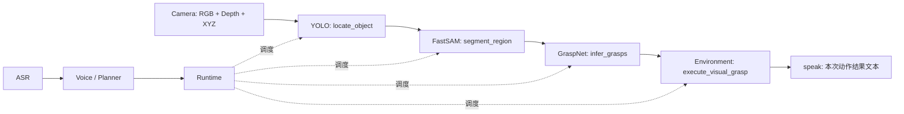

# 语音指定目标 → 视觉抓取

当前已接通 YOLO/YOLO-World 定位 → FastSAM 框提示 → GraspNet 候选 → WRS 虚拟抓取。
SAM3 原生文字分割入口保留；分割节点只有一套生命周期，Sam3Node 是兼容别名。
用户指定 D405 固定在桌边，尚无实测相机外参。GraspNet 环境与 RealSense 权重已准备，
已对官方 RGB-D 示例中 YOLO-World/FastSAM 选出的香蕉完成真实训练模型推理。
SAM3 SDK 已准备；FastSAM-x 已下载并通过 GPU 图像分割检查。
FastSAM + CLIP 直接选掩码的旧实验发现误选，不作为当前示例路径。新路径由 YOLO-World
使用完整英文目标定位，再由 FastSAM 分割框内物体；两张实图有定性检查，仍有漏检。
D405 节点到全部真实模型的联合运行及物理抓取仍未验证。
用户入口是 [RealSense 示例 00–06](../examples/grasping/README.md)，全部顶部配置、
无脚本参数。虚拟模型/标定只在 tests/fixtures/grasping 中供回归使用，不能用于硬件。

## 已下载的 FastSAM-x

选择官方 Ultralytics assets `v8.4.0` 的 FastSAM-x（144,972,346 字节，约 145 MB）。
按需抓取场景先用 x 验证掩码；未在用户桌面上比较 s/x，不宣称质量或时延优势。
官方 SHA256、下载 URL、asset ID 及 AGPL-3.0 许可来源在
[`fastsam_assets.json`](../wrs_agent/nodes/segmentation/fastsam_assets.json)。
权重位于 `.local/models/fastsam/FastSAM-x.pt`，Git 忽略。

```powershell
$env:WRS_AGENT_PYTHON = 'python'
./scripts/setup_vision.ps1
& 'python' -X utf8 -S scripts/download_fastsam.py --download
& '.local/venvs/vision/Scripts/python.exe' scripts/check_fastsam.py
```

setup 安装锁定的 fastsam extra，在独立 `.local/venvs/vision` 安装 SDK。下载入口流式写
临时文件，通过大小/SHA256 后原子放置；已存在文件只复核，不覆盖不匹配权重。
检查入口离线加载真实权重，在 SDK 自带 bus.jpg 上运行分割，复用结果做框提示；
不连接相机/机器人、不上传图片、不加载文本编码器。自有图片通过 `--image <本地路径>`。

实测 RTX 5060 Laptop / Torch 2.9.0+cu128 / Ultralytics 8.4.175：生成 70 个掩码，
框提示选出 1 个。报告 `reports/fastsam_inference.json`。这证明权重/图像推理可用，
不代表桌面识别或语音目标定位通过。

## YOLO 定位与 FastSAM 框提示

`locate_object(target, selection)` 在 YOLO 节点取得一次完整 RGB/Depth/XYZ，再执行检测。
结果 `location_id` 指向该任务保留的观测和目标框。`segment_region(location_id)` 直接
查询定位节点的那份数据，用框选掩码；不再向 Camera 请求 latest。Planner 显式安排
这两个步骤，传引用而不搬运图像，后面仍是 `infer_grasps` 和 Environment 动作。

普通 YOLO 只接受自身类别中的精确标签，不会把 red cup 偷换为 cup；配置本地
`clip_weights` 时使用 YOLO-World，把整个目标短语编码进检测网络。它与对已经生成的
掩码做 CLIP 排名不同。连续播报保留默认类别；目标检测在同一工作线程执行，结束或
失败都会恢复原词表。没有再创建一套节点生命周期。

本机复用 已有本地 yolov8m-worldv2.pt，57,233,192 字节，与官方 assets
v8.4.0 的 SHA256 一致，复制到 `.local/models/yolo/yolov8m-worldv2.pt`；没有新增下载。
来源、哈希及 AGPL-3.0 许可清单是 `nodes/vision/assets.json`。文字编码器复用下一节
所述的已校验 CLIP，节点禁止自动下载。新机器必须显式准备两份资产。

FastSAM 掩码的外接框与检测框 IoU 至少 .5、与次优掩码分差至少 .05，否则拒绝。多个检测目标默认
拒绝，仅用户指定时选择最左/最右；触及 32 个检测框或 100 个分割候选上限也拒绝。
这些是初始筛选参数，不能代替识别率和抓取成功率验收。`score_kind=box_iou` 与
嵌入的 LocationInfo 保存检测置信度、定位权重/文本权重、任务归属和原观测身份。

真实本地图片检查，不启动节点、相机或机器人：

```powershell
& '.local/venvs/vision/Scripts/python.exe' scripts/check_box_segmentation.py
& '.local/venvs/vision/Scripts/python.exe' scripts/check_box_segmentation.py --image <本地图像> --target 'green pepper'
```

检查脚本按 EXIF 方向解码、缩至最多 1280×1080，框和掩码始终使用该网格。实际公交图
的 bus 掩码覆盖可见车体并排除前景行人；elephant 被拒绝，person 多目标被拒绝。本机
桌面照片的 green pepper / tomato 掩码对应正确区域，但 onion 漏检。此前未处理 EXIF
的失败报告也保留。证据在 reports/box_segmentation*.json 和保存的掩码，人工核对为
定性检查，没有像素标注基准或深度数据，不能据此确认真实抓取。

追加官方 RGB-D 示例检查发现：香蕉正确掩码只占检测框约三成，旧像素 mask/box IoU
门槛误拒绝了弯曲形状；因此改为上述外接框比较，没有直接降低门槛。新指标 .921，
次选混入相邻物体的掩码为 .542，正确掩码通过。公交、青椒、番茄的像素掩码与旧报告
完全一致。指标语义变更明确记录为 box_iou，不能与旧报告的 box_mask_iou 数值混用。

可离线准备同帧 RGB-D/XYZ 输入（使用已下载的固定 baseline 示例，不连接设备）：

```powershell
./scripts/setup_graspnet.ps1
& '.local/venvs/graspnet/Scripts/python.exe' scripts/prepare_graspnet_example.py
& '.local/venvs/vision/Scripts/python.exe' scripts/check_box_segmentation.py --observation reports/graspnet_example.npz --target banana --report reports/graspnet_rgbd_corrected.json
```

该模式保留 1280×720 原网格，不旋转或缩放。示例只提供深度/内参，准备脚本按官方
针孔模型生成离线 XYZ；相机节点仍直接提供 SDK 点云，此处不改变线上点云合同。
香蕉有 13,865 个有效目标点，深度约 .421–.488 m；保存的
`reports/graspnet_rgbd_corrected_0_input.npz` 可交给 check_graspnet.py --input。
原 RGB、深度、全部场景 XYZ 原样保留，另存目标 mask、数据文件哈希和模型来源；
metadata 明确 live_observation=false。随后已用该文件完成下节 GraspNet 训练模型推理；
仍不是 D405 实机数据或物理抓取验证。示例中的 drill 漏检仍记录为失败。

节点示例配置均在文件顶部：02 为 YOLO-World，03 为 FastSAM，04 为 GraspNet。
默认与 camera 共用会话 `wrs-demo`、回环 7449、口令组 `wrs`。先运行本目录 00 Router
和 01 RealSense；已有 camera 的对应节点时复用，不重复启动。完整顺序和解释器见
[grasping/README.md](../examples/grasping/README.md)。

```powershell
& '.local/venvs/vision/Scripts/python.exe' -m examples.grasping.02_start_locator
& '.local/venvs/vision/Scripts/python.exe' -m examples.grasping.03_start_fastsam
```

分别在两个终端运行。节点 ID 为 `yolo` 和 `segmentation`；03 只公布 segment_region。
GraspNet 默认连接 `segmentation`，本机环境/源码/权重已准备。05 启动 Agent，06 提交
三步感知任务并读取本次候选，拒绝合成相机和旧任务结果；不提交虚拟/真实运动动作。
`SegmentationOptions(backend="sam3")` 保留 segment_object；`backend="fastsam"` 加本地
CLIP 权重可复现下述旧实验，当前 03 默认 `fastsam-box` 不加载 CLIP。

## 早期 FastSAM 文字匹配实验与限制

文字匹配复用本机已有 OpenAI CLIP ViT-B/32，353,976,522 字节；校验官方源码 URL 中的
SHA256 后复制到 `.local/models/fastsam/ViT-B-32.pt`，没有额外下载。固定提交、MIT
许可和校验值见 `nodes/segmentation/clip_assets.json`。新机器需另行显式准备该文件；
SDK 安装和节点启动都不会自动下载它。

FastSAM 先生成至多 100 个候选掩码，再用 CLIP 每批 8 张匹配英文目标。触及候选上限、
无匹配、多个匹配、第一/第二候选分差不足均拒绝。初始余弦阈值 .28、分差 .03 是开发
参数，**不是校准过的存在概率**。分割结果携带 `score_kind=clip_cosine` 和两份权重
的 SHA256；SAM3 分数仍为 `sam3_presence_class`，两者不能直接比较。

离线复现，不启动服务或连接设备：

```powershell
& '.local/venvs/vision/Scripts/python.exe' scripts/check_fastsam_text.py
& '.local/venvs/vision/Scripts/python.exe' scripts/check_fastsam_text.py --image .local/venvs/vision/Lib/site-packages/ultralytics/assets/bus.jpg --target bus --target elephant --target person --report reports/fastsam_text_bus.json
```

实际结果：zidane.jpg 的 `tie` 输出一个掩码（.2956），但人工对照保存的掩码发现选中了
衬衫区域而非领带；`elephant` 被拒绝。bus.jpg 的 `bus` 因分差不足被拒绝，存在的
`person` 也未达到阈值。报告 `fastsam_text.json` 的 selected 只表示算法选择，不代表
语义正确。掩码在 `reports/fastsam_text_0_mask.png`。没有为让样例通过而降低阈值。

因此不建议用该旧实验直接确定真实抓取目标。当前示例采用上节的检测框链；复杂目标
仍需要实测，不把 YOLO-World 支持短语输入理解为理解任意语言。
[FastSAM 官方接口](https://docs.ultralytics.com/models/fast-sam/)提供框/点提示。

## 数据与调度



分割节点在 RGB 上推理，用 mask 选择同帧原生深度和 XYZ。点云仍是 Camera
必需输出，不由消费节点重新反投影。SAM3 本身支持文本定位，抓取不强制先跑 YOLO；
YOLO 同时保留原有检测/播报用途。多个目标匹配时默认失败，只有用户指定才选最左/最右。

Planner 只传目标与步骤结果引用。图像、掩码、点云直接在节点间传输，不经 Agent。
分割/YOLO 共享观测身份、像素网格和来源语义；选中掩码另带任务归属及完整观测。
GraspNet 使用独立三维抓姿合同，分数不是概率，也不是物理抓取成功的确认。
网格和坐标系来自 Observation.alignment / frame_id，消费者不硬编码 depth_grid。
当前 RealSense 驱动已声明 color_grid；原 depth-optical 外参不可直接用于 color-optical。

| 所有者 | 技能 / 输出 |
|---|---|
| `nodes/vision/` | locate_object → location_id、observation_id |
| `nodes/segmentation/` | segment_region(location_id) 或 segment_object(target) → segment_id、observation_id |
| `nodes/grasp/` | infer_grasps(segment_id) → candidate_set_id、observation_id、count |
| `env/wrs_grasp.py` | execute_visual_grasp(candidate_set_id) → object_id、observation_id、text |
| 原 TTS | speak(text)，通过 Step.inputs 接收动作结果 |

二进制查询为 `request/vision/location`、`request/segmentation/data`、`request/grasp/data`，请求带 artifact_id 和
task_id。生产者校验启动身份、control_epoch、原动作 SUCCEEDED 和有效期。不同任务、
取消、重启或过期结果不可复用；失效不回退 latest。Environment 仍通过原 ActionContext
接受动作，数据编号不授予运动权限。GraspNet 数据保留整场景 XYZ，供碰撞检查使用。

## 内存、生命周期和时效

Camera 最近两帧，每帧 RGB uint8 + Depth uint16 + XYZ float32：848×480 约 6.60 MiB。
YOLO 定位、分割节点、GraspNet 各保留至多两份任务结果及完整观测，上限各 64 MiB，按原观测年龄
最多 30 秒，定期清理。推理持有的输入不受相机环形缓存更新影响。

这是缓存上限，**不是进程总内存上限**：模型权重、中间张量、一个在途任务及有界传输
缓冲另占内存。每个模型只有一个工作线程/在途动作，不逐帧无限提交任务。YOLO 连续
播报仍只读取 RGB；按任务定位时才取完整观测。同一线程最多排队一项连续检测和一项
任务定位；两个调用都等待结果，不随帧数增加队列。
取消禁止发布迟到结果；Python 无法硬抢占 GPU kernel，推理返回后才确认该动作取消。
机器人控制走独立路径，不等待另一个节点的推理。

## 固定相机与虚拟 Environment

外参定义 `p_world = T_world_camera @ p_camera`，world 为当前机器人基座系。
FixedCameraCalibration 显式记录 camera_frame、calibration_id、来源及 4×4 变换；
缺标定、坐标系不匹配、非法矩阵或过期观测都拒绝，没有 identity 默认值。
`virtual_camera.json` 标记 virtual_fixture，不能通过真实硬件校验。

可选 `wrs-grasp` backend 保留原 WRS 节点入口和单线程模型所有权，依次：

1. 把分割点转换到 world，在配置方块中唯一匹配目标；未建模场景点导致拒绝。
2. 转换 GraspNet +x 接近/+y 闭合轴到 DH50 +z 接近/+x 闭合轴。
3. 创建真实碰撞体，验证 IK、关节限位、预抓取路径和直线接近；接近时目标也参与碰撞。
4. 约每 1 mm 检查夹爪闭合，仅允许两指与目标接触；检查方块对向面捕获条件。
5. 建立虚拟刚性夹持，携带物体检查抬升路径，读回 FK/物体位置验证抬高 8 cm。

验证范围是已知方块的几何/刚性连接，不是动力学、摩擦或接触力。原 3 cm 示例方块与
DH50 碰撞网格冲突，已被拒绝；有限例子使用 1 cm 方块。GraspNet depth 不直接等同
DH50 TCP 偏置，真实工具变换与抓持反馈仍需校验。本 backend 没有 UR 驱动或硬件切换。

固定 WRS 提交中的 viewer 物体默认没有碰撞体，此 adapter 显式创建局部 AABB 盒体。
MuJoCo 转换器应用结构忽略时可能漏掉挂载夹爪，adapter 因此补用 DH50 **已经声明**的
手指结构忽略。未改 submodule、普通 WRS 运动或用户的 UR 驱动修改。

## 运行与真实模型入口

示例改为真实 RealSense 和模型，按 00–06 启动；没有合成相机或模型替身。完整命令与
配置见 [grasping/README.md](../examples/grasping/README.md)。本页的虚拟后端验证仅供
开发回归，通过下面的测试运行，无设备或云调用：

```powershell
& 'python' -X utf8 -S scripts/run.py -m pytest tests/integration/test_visual_grasp.py -q
```

该测试保留实际 Planner / ASR / Voice 协议、Zenoh 与 WRS 虚拟几何验证，使用 tests
目录的显式模型夹具和 Mock TTS，不是 RealSense 端到端实测。示例脚本不会安装或下载。

SAM3 使用 Transformers 图像 API，独立环境包含锁定的 Transformers 5.15.1、
Torch 2.9.0 CU128、Torchvision 0.24.0 CU128；不改变已有语音环境：

```powershell
$env:WRS_AGENT_PYTHON = 'python'
./scripts/setup_sam3.ps1
& '.local/venvs/sam3/Scripts/python.exe' scripts/check_sam3.py --report reports/sam3_sdk.json
```

安装脚本只安装 SDK，不下载模型。默认检查在 GPU 上用测试张量运行实际 SDK 后处理，
验证掩码尺寸、目标选择、歧义和无效输出拒绝；报告仍将 trained_inference 标为 unverified。
模型适配器先选框，再仅放大选中掩码，避免为所有候选创建全分辨率 int64 掩码。

真实模型需先由操作者获得 [facebook/sam3 访问授权](https://huggingface.co/facebook/sam3)，
按 revision `3c879f39826c281e95690f02c7821c4de09afae7` 准备本地目录，包含
`model.safetensors`（3,439,938,512 字节）及 `nodes/segmentation/assets.json` 所列配置、
分词文件和 LICENSE。公开元数据隐藏权重哈希，本项目**没有已核实的官方权重 SHA256**；
必须另外取得可信校验值，不能把刚下载文件的自算值当作来源核验。

已获得官方访问授权并接受许可后，可显式运行以下命令。脚本只读环境变量 HF_TOKEN，
先从官方已授权元数据取得固定版本的 SHA256；若仍隐藏则在下载前报错。下载后复核
权重及所有配置，输出可传给节点的权重路径与 SHA256，不加载模型或连接设备：

```powershell
& '.local/venvs/sam3/Scripts/python.exe' scripts/download_sam3_model.py --download
```

默认存入 `.local/models/sam3`，不进 Git。尚未实际运行此下载，也未替操作者接受许可。

SAM3 适配器需要本地 model.safetensors 路径和可信 SHA256；加载前核对权重
及固定配置的 Git blob 哈希，拒绝额外的配置侧文件；加载使用 local_files_only、
use_safetensors 和 trust_remote_code=False，没有网络回退。旧 Meta SDK 的 `sam3.pt`
格式不再由此入口接收。下载和许可接受仍由操作者显式执行，凭据只能放环境变量。

取得上述文件后，可先离线验证一张已有图片，不连接相机或机器人：

```powershell
& '.local/venvs/sam3/Scripts/python.exe' scripts/check_sam3.py --weights <目录/model.safetensors> --sha256 <可信SHA256> --image <本地图像> --target 'red box' --report reports/sam3_inference.json
```

`--selection leftmost/rightmost` 仅用于明确指定方位的图片检查。8 GiB GPU 上真实 SAM3
与语音模型同时常驻的峰值占用/时延尚未验证，SDK 张量测试不代表完整模型能并行运行。

GraspNet 使用独立环境和固定的官方 baseline 提交
`280c215129f759ed8649cb4e89fc5dfee55f4f80`。Windows / Python 3.12 / Torch 2.9 CU128
的 PointNet2、KNN 扩展已实际编译并通过数值检查。04_start_graspnet 顶部配置 .local 下固定源码和
已校验训练权重；节点先核对 Git HEAD 与已跟踪源码无修改，再加载模型。

```powershell
# 默认只安装锁定的 SDK；显式开关另下载源码和三个 CUDA 编译组件，不下载模型权重。
./scripts/setup_graspnet.ps1 -BuildExtensions
& '.local/venvs/graspnet/Scripts/python.exe' scripts/check_graspnet.py
```

CUDA 12.8.1 的 nvcc/cudart/cccl 来自 NVIDIA 固定版本清单，约 127 MB，下载后核对大小
及官方 SHA256，解压在 `.local/cuda/12.8.1`；无需安装系统 Toolkit、驱动或修改系统
PATH。编译使用本机 VS 2022 C++ 工具，当前实测 MSVC 14.44。安装脚本不会自动安装
MSVC；缺少时明确失败。源码位于 `.local/src/graspnet-baseline`，不是 submodule。

兼容调整仅应用到 `.local/build/graspnet-extensions` 中的编译副本：KNN 改用 int64_t
索引（Windows long 为 32 位）、使用当前 Torch 指针/流接口和所需的 CUDA 头文件、
MSVC 编译参数。原始模型 Python 与 CUDA 算法保持原逻辑；没有替换为 Python 近似算法。
每个编译输入的哈希记录在该目录 build_sources.json，副本保留上游 LICENSE，安装为
独立的 wrs-graspnet-extensions 本地包。`uv sync --inexact` 保留这个本地构建包。
官方模型无条件导入 label_generation → knn_modules，推理也需要 KNN 扩展。

有限检查对照参考计算验证 FPS、gather、3NN、插值、球邻域、group、旋转圆柱邻域、
CPU/CUDA KNN 的 64 位索引；CUDA 检查使用非默认流。还运行 20,000 点的完整网络和
pred_decode。默认使用随机初始化，报告明确区分 untrained_network 与
trained_inference；前向通过不代表模型已经能够预测可用抓姿。

用户已明确授权非商业内部研究用途。权重下载与离线推理可复现为：

```powershell
& 'python' -X utf8 -S scripts/download_graspnet.py --download
& '.local/venvs/graspnet/Scripts/python.exe' scripts/check_graspnet.py --weights .local/models/graspnet/checkpoint-rs.tar --sha256 60680087c61cba2b6791614fef1519071e294f6dcaf99b3f581bb95f7c51a868 --input reports/graspnet_rgbd_corrected_0_input.npz --report reports/graspnet_trained.json
# 需要运行常驻节点时，由操作者另开终端；默认连接 FastSAM 的 segmentation 节点。
& '.local/venvs/graspnet/Scripts/python.exe' -m examples.grasping.04_start_graspnet
```

NPZ 需包含相同网格的 float32 `points[H,W,3]`（米）和 bool `mask[H,W]`，读取不允许
pickle。该检查不执行机器人动作。源码许可限非商业内部研究，见
[官方许可](https://github.com/graspnet/graspnet-baseline/blob/280c215129f759ed8649cb4e89fc5dfee55f4f80/LICENSE)。
官方 RealSense checkpoint 文件 ID 为 `1hd0G8LN6tRpi4742XOTEisbTXNZ-1jmk`，公开响应头
和实际下载大小为 12,468,415 字节。公开来源未提供 SHA256；资产清单
[`nodes/grasp/assets.json`](../wrs_agent/nodes/grasp/assets.json) 固定用户批准的首次下载
哈希用于后续一致性检查，不代表官方哈希核验。LICENSE 和首次下载记录位于同一忽略
目录 .local/models/graspnet；已有文件校验不匹配会拒绝，不覆盖或运行时重新下载。

本机训练模型实际以 13,865 个有效香蕉点采样到 20,000 点，生成 32 个符合 .05 m
最大夹爪宽度的候选，开口约 .0427–.0500 m。报告保存输入文件/模型哈希、原数据来源、
候选坐标和分数。分数为 graspnet_quality，不是成功概率；collision_checked=false，
physical_grasp=not_tested。加载使用 weights_only=True，没有开启任意 pickle 回退。

语音复用已有 ASR/Voice：System.send_text(text, input_id=press_id) 交给显式启用的
Planner，可信“停止”走本地控制。通过 WrsOptions(backend="wrs-grasp", scene=...,
grasp_calibration=...) 配置虚拟执行；回归夹具展示该配置，普通后端不会被静默替换。

## 尚未完成

完成条件复核（2026-10-13）：

| 原目标环节 | 当前证据 | 尚缺什么 |
|---|---|---|
| 分割节点与 GraspNet 节点 | 实际节点/技能/同帧数据合同已实现，Zenoh 夹具链通过 | 真实 D405 节点到训练 GraspNet 的整链验收 |
| 按物体名称定位和分割 | YOLO-World/FastSAM 本地权重实图执行；香蕉 RGB-D 输入已保存 | 更多实景质量验证；已有 onion/drill 漏检 |
| 三维抓姿预测 | 原生扩展/9 项数值检查和训练权重香蕉推理通过，32 个候选 | 桌面实景候选质量、实际夹爪/场景碰撞验证 |
| 语音调度与播报 | 离线 ASR/Planner 协议夹具到 WRS 虚拟抓取、Mock TTS 通过 | 真实语音/模型与完整感知链的联合验收 |
| 机器人抓取物体 | 仅 WRS 已知方块的虚拟夹持/抬升通过 | 真实视觉抓取执行适配尚未实现，实测外参/工具变换/场景碰撞/接触反馈和现场验收仍缺失 |

`execute_visual_grasp` 当前只由 wrs-grasp 虚拟后端提供。UR 后端的基础运动/夹爪读回
不能替代此能力；它尚未消费 candidate_set_id，也没有视觉目标夹持成功验证。
不能把虚拟标定改名为 measured、把候选抓姿直接发到 UR，或把夹爪 CAUGHT 当作抓取成功。
后续按实测标定和具体夹爪反馈实现真实 Environment 接口，检查实际候选与场景碰撞。

桌面定位/分割质量和真实深度链仍待验收；SAM3 实际权重与推理未验证（当前选用
FastSAM）；GraspNet 已有离线训练模型证据，Graspness 尚未适配。
还需实测 D405 外参及移动后失效流程、真实场景建模、工具变换、物理夹持/掉落/抬升反馈
和实机停止验收。完整物理抓取目标保持进行中，不能用虚拟通过替代。

接口依据：[SAM3](https://github.com/facebookresearch/sam3)、
[Transformers 图像接口](https://huggingface.co/docs/transformers/model_doc/sam3)、
[GraspNet baseline](https://github.com/graspnet/graspnet-baseline)、
[抓姿格式](https://github.com/graspnet/graspnetAPI/blob/master/graspnetAPI/grasp.py)。
